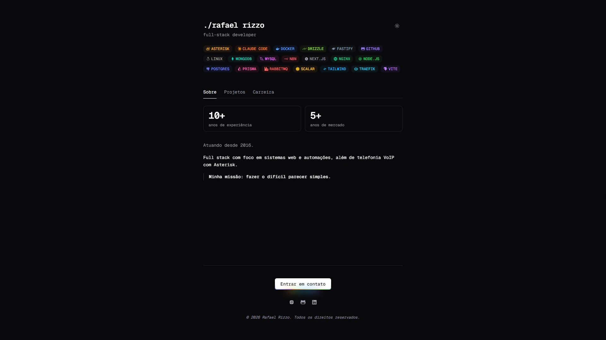

# ./rafael rizzo

Portfólio de Rafael Rizzo, desenvolvedor full stack: minimalista, em dark mode e com foco em hierarquia e detalhes de animação.

**https://rafael-rizzo.com**



## Como foi feito

### Stack

- [Vite](https://vite.dev), [React 19](https://react.dev) e TypeScript
- [Tailwind CSS v4](https://tailwindcss.com) e [shadcn/ui](https://ui.shadcn.com) (Radix)
- [Motion](https://motion.dev) e [Magic UI](https://magicui.design) para as animações
- Deploy na Vercel

### Da v1 em Next.js para o Vite

O site era em Next.js e a v3 foi refeita em Vite. Por ser uma página única, sem rotas nem servidor, o código ficou bem menor: saíram dezenas de componentes shadcn que não eram usados, e ficaram só os que o site precisa (tabs, badge, button, tooltip e terminal).

### Design

- **Minimalista e dark por padrão**, com uma paleta zinc em oklch e uma fonte mono (Geist Mono).
- **Hierarquia clara**: nome e cargo, depois a stack, depois as abas Sobre, Projetos e Carreira, e o contato por último.
- **Badges de tecnologia**: no dark, fundo e borda têm exatamente a mesma cor, sólida e sem transparência. A cor é a da marca misturada a 10% sobre o fundo (`color-mix`), com o texto em tom mais claro para manter o contraste. Cada uma das 20 badges tem uma cor própria e estão em ordem alfabética.
- **Projetos sem corte**: as imagens são webp e mantêm a proporção real (com `width` e `height` no HTML, o que também evita saltos de layout). Projetos de linha de comando usam um terminal animado no lugar da imagem.

### Animações e detalhes

- **Troca de tema** em revelação circular a partir do botão, com a View Transitions API. Sem suporte ou com `prefers-reduced-motion`, a troca é direta.
- **BlurFade** na entrada dos blocos e dos projetos (ao entrar na tela), badges em cascata, underline das abas que desliza entre elas (`layoutId`) e linha do tempo da carreira que se desenha.
- **Anel de foco só no teclado**: o `:focus-visible` nativo também liga depois de um clique seguido de qualquer tecla (espaço, `/`, PageDown), o que fazia o anel aparecer do nada nas abas. Um pequeno rastreador marca no `<html>` se a última interação foi por teclado ou mouse, e o CSS só mostra o anel no primeiro caso.
- `MotionConfig` com `reducedMotion="user"` respeita a preferência de movimento reduzido do sistema.

### SEO e descoberta por IA

O site é uma SPA, então o HTML bruto chegaria vazio para crawlers e LLMs que não executam JavaScript. Para resolver isso, um plugin do Vite (`seo/seo-plugin.ts`) roda no build e gera, a partir dos mesmos arquivos de dados que alimentam a interface:

- o conteúdo completo da página em HTML (pré-renderizado), que o React substitui ao montar;
- meta tags, Open Graph, Twitter Card e JSON-LD (schema.org: Person, WebSite, ProfilePage e a lista de projetos);
- `llms.txt` e `llms-full.txt`, com resumo e carreira em markdown para LLMs;
- `sitemap.xml` com `lastmod`.

O `robots.txt` libera explicitamente os crawlers de IA (GPTBot, ClaudeBot, PerplexityBot, Google-Extended e outros), e a imagem de compartilhamento (1200×630) foi gerada por um HTML renderizado em headless.

### Estrutura

```
src/
  components/
    ui/           shadcn/ui
    magicui/      BlurFade, RainbowButton, AnimatedThemeToggler
    sections/     header, about, projects, career, footer, tab-section
  data/           conteúdo (perfil, carreira, projetos, stack, SEO)
  lib/            utilitários
seo/              plugin de SEO do Vite
public/projects/  imagens dos projetos
```

O conteúdo vive em `src/data/`, separado da interface: o mesmo dado alimenta a tela, o HTML pré-renderizado, o JSON-LD e o `llms.txt`.
